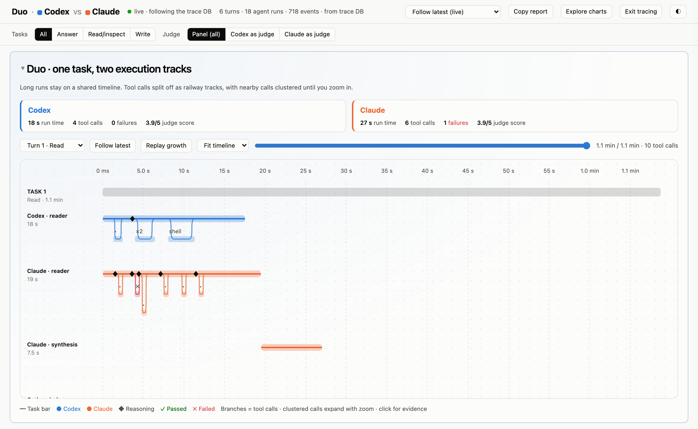
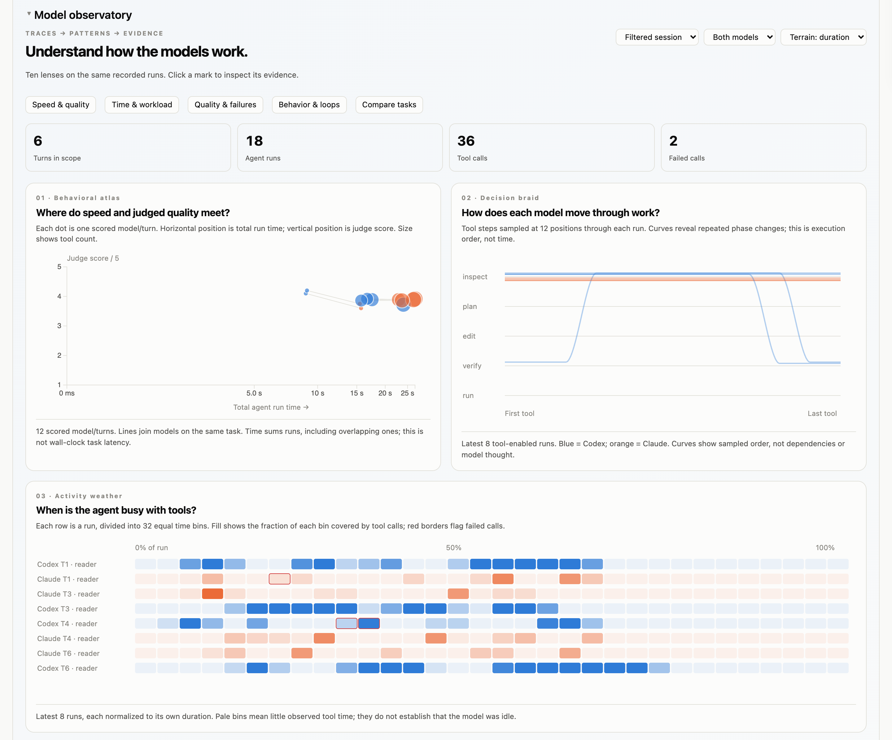
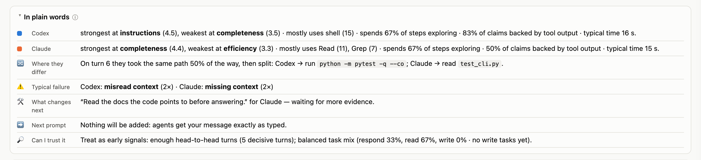

# duo

Ask once and get **Codex and Claude side by side** in one terminal. duo traces every run, has both models judge the answers blind, and shows the results in a local viewer, so you can see which model does better on *your* work and why.



## What it does

- **Asks both.** Questions go to both models in parallel. You get both answers plus a short combined answer.
- **Runs both as agents.** For read/inspect tasks, both tool-enabled agents run in parallel. For change requests, one agent writes, the other reviews read-only, and the writer gets one repair pass.
- **Judges blind.** After each turn, Codex and Claude each grade both answers with model names hidden, in both A/B orders. A win counts only if both orders agree.
- **Records everything locally.** Prompts, tool calls, reasoning and scores go to SQLite at `~/.duo/traces.db`.
- **Learns carefully.** Fixes the judges keep suggesting become short lessons appended to future prompts. Each lesson is measured, and it is retired if it hurts. Your own message is never edited.

## Setup

You need Python 3.12+ and the `codex` and `claude` CLIs on `PATH`, already logged in. duo reuses their auth and config.

```sh
git clone https://github.com/sugeerth/duo && cd duo
pip install --target vendor claude-agent-sdk   # Claude agent backend (vendor/ is gitignored)
pip install rich prompt_toolkit                 # optional: nicer terminal UI
ln -s "$PWD/duo.py" ~/.local/bin/duo
```

## Use

```sh
duo                         # chat
duo "question"              # one answer from each, plus a combined answer
duo --work "task"           # both agents do the task with tools
duo --agent claude "task"   # one agent only
```

In chat: `/both` · `/separate` · `/codex` · `/claude` · `/work TASK` · `/context PATH` · `/judge panel|codex|claude|agent|off` · `/traces` · `/help` · `/exit`

## Viewer

duo prints a local viewer URL (`/traces` shows it again). The viewer follows the live session and works offline.





*Screenshots come from a made-up demo session.* To try the viewer without API keys:

```sh
python3 tools/demo_trace.py /tmp/duo-demo.db
DUO_TRACE_DB=/tmp/duo-demo.db python3 tools/serve_viewer.py 8790   # open http://127.0.0.1:8790
```

## Permissions and privacy

- duo shows each CLI's own approval prompts and never bypasses them. Codex writes inside a workspace-write sandbox, and reviewers are read-only.
- Traces stay on your machine (`DUO_TRACE_DB=off` turns them off). Your prompts still go to OpenAI and Anthropic.

## Tests

`python3 test_duo.py` runs 52 unit tests with no API calls. `smoke_live.py` and `smoke_action.py` call the real CLIs and use quota.

**More:** every command, the judge rubric, the learning loop, eval sets and exports are in [docs/REFERENCE.md](docs/REFERENCE.md).
